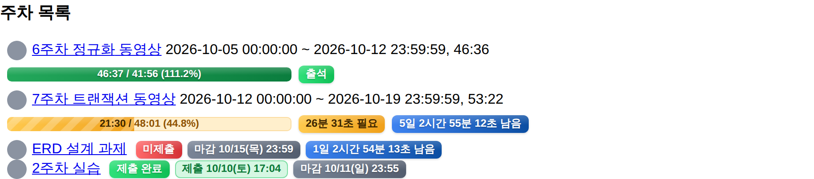

# HSU Plus

> 매일 들어가는 e클래스 안에서, 흩어진 학교 생활 정보를 한눈에.

한성대학교 e클래스·비교과(스마트자기관리시스템)·종합정보시스템의 정보를 모아
e클래스 화면 안에 보여주는 크롬 확장 프로그램 프로토타입입니다.
**2026 제2회 한성 아이디어 경진대회** 출품작(분야 1: AI 학생 맞춤형 대학 서비스)입니다. ([대회 안내](https://www.hansung.ac.kr/hansung/6029/subview.do?enc=Zm5jdDF8QEB8JTJGYmJzJTJGaGFuc3VuZyUyRjIxNDQlMkYyMjQzNzAlMkZhcnRjbFZpZXcuZG8lM0ZwYWdlJTNEMSUyNmZpbmRUeXBlJTNEJTI2ZmluZFdvcmQlM0QlMjZmaW5kQ2xTZXElM0QlMjZmaW5kT3Bud3JkJTNEJTI2cmdzQmduZGVTdHIlM0QlMjZyZ3NFbmRkZVN0ciUzRCUyNnBhc3N3b3JkJTNEJTI2))

> 학생이 만든 프로토타입이며, 학교 공식 서비스가 아닙니다.

## 화면
> 아래 화면은 모두 **가짜 데이터**로 만든 예시입니다. 실제 계정 정보는 들어 있지 않습니다. (`node tools/screenshots.mjs`로 다시 만들 수 있음)

<table>
<tr>
<td align="center"><br><sub>이번 주: 남은 강의·과제·퀴즈·비교과</sub></td>
<td align="center"><br><sub>비교과: 졸업 포인트, 설문 필요, 내 일정</sub></td>
<td align="center"><br><sub>AI: 자주 묻는 질문 버튼</sub></td>
</tr>
</table>

<br><sub>강의실(과목 페이지): 출석 진도, 더 들어야 할 시간, 과제 제출 여부</sub>

## 주요 기능
- **이번 주** — 남은 강의·과제·퀴즈·비교과를 마감 순으로. 마감 위험도 색, 출석까지 남은 시청 시간, 지금부터 들어도 출석이 어려운 강의 안내, 필요 없는 항목 숨기기
- **강의실 표시** — 과목 페이지 목록에 출석/결석, 진도 막대(출석 기준 = 영상 길이의 90%), 남은 시간, 과제 제출·늦은 제출 표시
- **캘린더** — 이번 주 시간표 + 날짜·시각이 정해진 내 비교과 일정
- **비교과** — 곧 신청 마감인 프로그램, 졸업 인정 포인트와 남은 점수, 아직 안 낸 설문, 시작 대기·진행 중 일정
- **AI** — "오늘 뭐 해야 돼?" 같은 질문에 실제 일정 카드로 답 (AI 서버 연결 전에는 브라우저 안 기본 답변)

## 왜 만드나요
- 과제·강의 영상은 `e클래스`, 비교과 일정·포인트는 `스마트자기관리시스템`, 시간표·학사 신청은 `종합정보시스템`에 흩어져 있습니다.
- 졸업생이 만든 비공식 확장 프로그램(각 약 1,000명, 평점 5.0)이 이미 쓰이고 있지만, 기능이 흩어져 있고 아는 사람만 씁니다.
- 이 프로젝트는 그 기능을 **e클래스에 공식 내장하자**는 제안이며, 확장 프로그램은 "내장되면 이렇게 보인다"를 실제 화면에서 보여주는 시연 도구입니다.

## 설계 원칙
1. **학습 관리는 돕되 학습 자체를 대체하지 않는다.** (영상 자동 재생·자동 수강 기능 없음)
2. **필요한 최소 정보만 읽는다.** 성적(평점)·등록금·연락처는 읽지 않습니다.
3. **읽기 전용.** 비밀번호를 저장하지 않고, 신청·제출을 대신하지 않습니다. 이미 로그인된 화면에서 정보를 읽기만 합니다.
4. **AI에는 꼭 필요한 것만.** 이름·학번·성적·연락처는 보내지 않습니다. AI 탭에서 직접 물을 때만 강의·과제·비교과 일정 범위의 최소 정보를 보내고, 서버에 저장하지 않습니다. 보낼 내용은 화면에서 미리 볼 수 있습니다. 공개된 비교과 안내문은 정리(분류·요약)에 씁니다.
5. **학교 사이트를 자동으로 긁지 않는다.** 비교과 사이트의 robots.txt를 존중해, 서버가 학교 사이트를 직접 읽지 않습니다.

## 설치 (개발 버전)
1. 이 저장소를 내려받습니다 (Code → Download ZIP 후 압축 해제, 또는 `git clone`).
2. 크롬 주소창에 `chrome://extensions` 입력 → 오른쪽 위 **개발자 모드** 켜기
3. **압축해제된 확장 프로그램을 로드합니다** → 이 폴더(`manifest.json`이 있는 폴더) 선택
4. [e클래스](https://learn.hansung.ac.kr)에 로그인 → 메인 화면 오른쪽 가장자리의 **+** 버튼 클릭

코드를 고친 뒤에는 `chrome://extensions`에서 HSU PLUS의 새로고침(↻) 버튼 → e클래스 새로고침.

## 구조
```
manifest.json      확장 설정·권한
background.js      service worker: 다른 사이트 요청, 캐시, AI 서버 호출
content/           e클래스 화면 (패널, 강의실 표시)
adapters/          사이트별 데이터 읽기 (eclass / hsportal / info)
core/              공통 데이터 형식, 캐시, AI 탭 답변·보낼 정보 정리
lib/               외부 라이브러리 자리 (지금은 비어 있음)
worker/            Cloudflare Worker: AI 서버 (질문 답변, 안내문 분류·요약)
tools/             README 스크린샷 만들기 (가짜 데이터)
docs/              계획, 마일스톤, 개발 일지, 사이트 분석 노트, 화면 예시(images/)
```

## 문서
- [기능 목록과 구현 계획](docs/PLAN.md)
- [마일스톤과 진행 방법](docs/MILESTONES.md)
- [개발 일지](docs/DEVLOG.md)
- [사이트 분석 노트](docs/SITE-NOTES.md)

## 참고
- 기존 비공식 확장 프로그램(hsu-ecx, HSU 돋부기)에서 착안했으며, 코드는 새로 작성했습니다.
