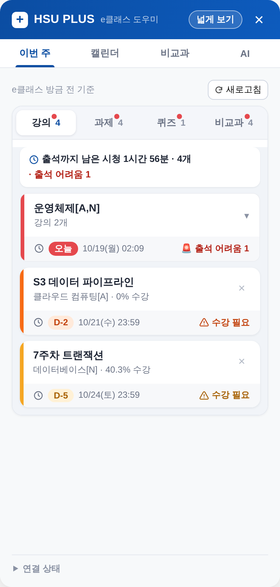
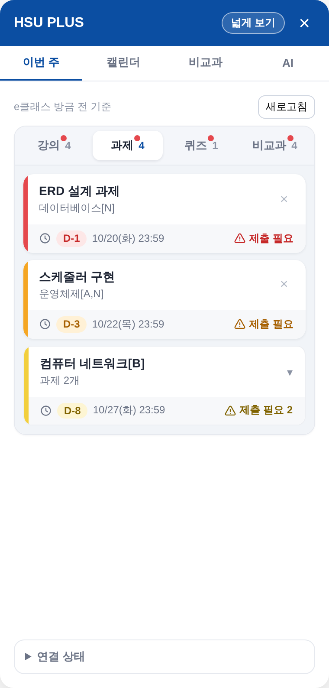
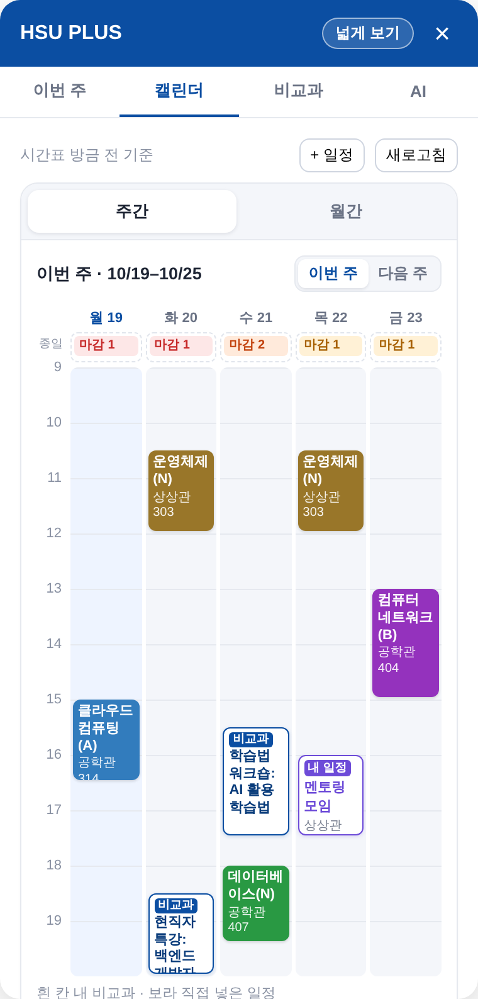
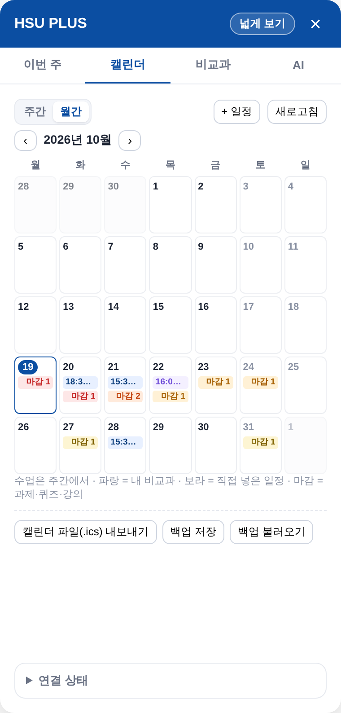
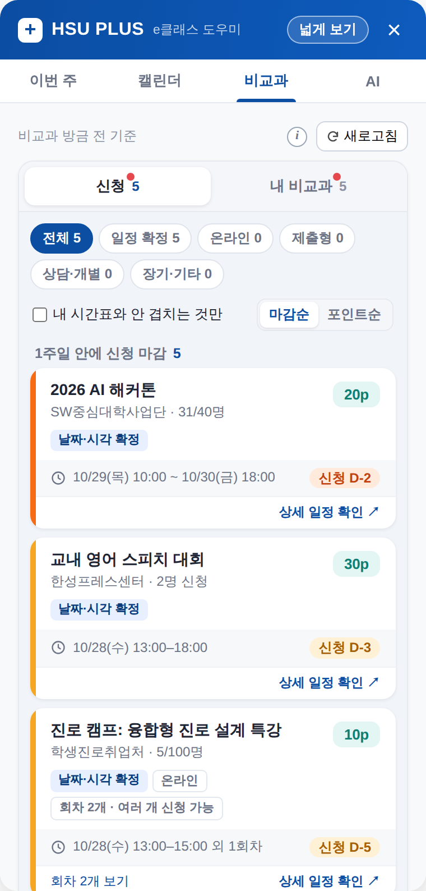
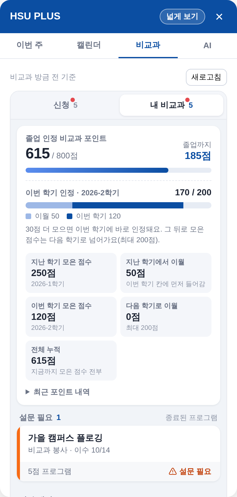
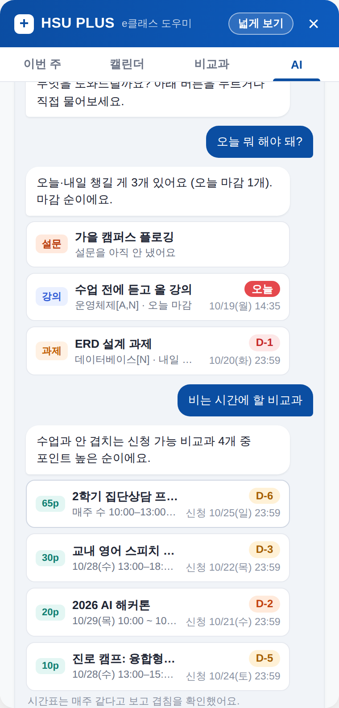

# HSU Plus

> 매일 들어가는 e클래스 안에서, 흩어진 학교 생활 정보를 한눈에.

한성대학교 e클래스·비교과(스마트자기관리시스템)·종합정보시스템의 정보를 모아
e클래스 화면 안에 보여주는 크롬 확장 프로그램 프로토타입입니다.
**2026 제2회 한성 아이디어 경진대회** 출품작(분야 1: AI 학생 맞춤형 대학 서비스)입니다. ([대회 안내](https://www.hansung.ac.kr/hansung/6029/subview.do?enc=Zm5jdDF8QEB8JTJGYmJzJTJGaGFuc3VuZyUyRjIxNDQlMkYyMjQzNzAlMkZhcnRjbFZpZXcuZG8lM0ZwYWdlJTNEMSUyNmZpbmRUeXBlJTNEJTI2ZmluZFdvcmQlM0QlMjZmaW5kQ2xTZXElM0QlMjZmaW5kT3Bud3JkJTNEJTI2cmdzQmduZGVTdHIlM0QlMjZyZ3NFbmRkZVN0ciUzRCUyNnBhc3N3b3JkJTNEJTI2))

> 학생이 만든 프로토타입이며, 학교 공식 서비스가 아닙니다.

## 화면
> 아래 화면은 모두 **가짜 데이터**로 찍은 예시입니다(실제 e클래스 위에서 시연 모드, `docs/DEMO.md`). 실제 계정 정보는 들어 있지 않습니다.

<table>
<tr>
<td align="center"><br><sub>이번 주 · 강의: 출석까지 남은 시청 시간, 출석이 어려운 강의, 위쪽에 학사 신청 기간</sub></td>
<td align="center"><br><sub>이번 주 · 과제: 마감 순, 제출 필요 표시</sub></td>
</tr>
<tr>
<td align="center"><br><sub>캘린더 · 주간: 시간표 + 비교과 + 직접 넣은 일정, 요일별 마감</sub></td>
<td align="center"><br><sub>캘린더 · 월간: 며칠 이어지는 일정은 막대로, 마감·비교과·학사일정</sub></td>
</tr>
<tr>
<td align="center"><br><sub>비교과 · 신청: 종류별 분류, 포인트, 내 시간표와 겹치는 회차</sub></td>
<td align="center"><br><sub>비교과 · 내 비교과: 졸업 포인트, 이번 학기 인정·이월, 설문 필요</sub></td>
</tr>
<tr>
<td align="center" colspan="2"><br><sub>AI: 직접 쓴 질문에 내 실제 일정·마감으로 답 (항목 이름을 눌러 바로 이동)</sub></td>
</tr>
</table>

## 주요 기능
- **이번 주** — 남은 강의·과제·퀴즈·비교과를 마감 순으로. 마감 위험도 색, 출석까지 남은 시청 시간, 지금부터 들어도 출석이 어려운 강의 안내, 필요 없는 항목 숨기기. 위쪽에 진행 중·곧 시작하는 학교 신청 기간(휴·복학, 수강신청, 전과 등)과 시험 — 학교 홈페이지 학사일정에서
- **강의실 표시** — 과목 페이지 목록에 출석/결석, 진도 막대(출석 기준 = 영상 길이의 90%), 남은 시간, 과제 제출·늦은 제출 표시
- **캘린더** — 주간(시간표 + 내 비교과, 매주 회차 포함 + 요일별 과제·퀴즈·강의 마감)과 월간. 톡방으로만 공지된 일정 등은 직접 넣기(날짜·시각 / 날짜만 / "그 달 중"). 일정마다 "구글 캘린더에 추가", 전체를 .ics 파일로 내보내기(구글·삼성·아이폰 캘린더에서 가져오기)
- **비교과** — 신청: 접수 중 프로그램을 종류(특강·행사 / 온라인 / 과제 제출 / 프로젝트 / 상담·개별 / 장기 / 기타)로 나누고, 포인트와 회차마다 수업과 겹치는지 표시. 마감순·포인트순 정렬, 내 시간표와 안 겹치는 것만 보기. 내 비교과: 졸업 인정 포인트와 남은 점수, 이번 학기 200점 칸(지난 학기 이월 포함)·다음 학기 이월 예상, 아직 안 낸 설문, 시작 대기·진행 중 일정. 800점을 넘으면 "내 비교과 점수"와 이번 학기 모은 점수만 크게
- **내 설정 동기화** — 숨긴 항목·과목 색·직접 넣은 일정은 같은 구글 계정으로 로그인한 크롬끼리 똑같이 보입니다(크롬 동기화 사용). 백업 파일로 저장·불러오기도 됩니다
- **AI** — 직접 쓴 질문("오늘 내 일정 제안해 줄래?")에 내 일정·마감·비교과를 근거로 답하고, 항목은 이름으로 짚어 줍니다(날짜·마감은 학교 정보 그대로). 자주 묻는 질문 버튼은 AI 없이 바로 답합니다. 질문할 때만 필요한 최소 정보를 보내고(보낼 내용 미리 보기), 서버는 저장하지 않습니다. 수업·과제·비교과와 관계없는 질문은 답하지 않습니다 (`docs/AI-SETUP.md`)
- **처음 안내 · 설정** — 처음 열면 세 사이트 로그인 확인과 탭 소개. 아래 "연결 상태 · 설정"에서 백업, 내 데이터 모두 지우기

## 왜 만드나요
- 과제·강의 영상은 `e클래스`, 비교과 일정·포인트는 `스마트자기관리시스템`, 시간표·학사 신청은 `종합정보시스템`에 흩어져 있습니다.
- 재학생이 만든 비공식 확장 프로그램들이 쓰이고는 있지만, 기능이 흩어져 있고 아는 사람만 씁니다.
- 이 프로젝트는 그 기능을 **e클래스에 공식 내장하자**는 제안이며, 확장 프로그램은 "내장되면 이렇게 보인다"를 실제 화면에서 보여주는 시연 도구입니다.

## 설계 원칙
1. **학습 관리는 돕되 학습 자체를 대체하지 않는다.** (영상 자동 재생·자동 수강 기능 없음)
2. **필요한 최소 정보만 읽는다.** 성적(평점)·등록금·연락처는 읽지 않습니다.
3. **읽기 전용.** 비밀번호를 저장하지 않고, 신청·제출을 대신하지 않습니다. 이미 로그인된 화면에서 정보를 읽기만 합니다.
4. **AI에는 꼭 필요한 것만.** 이름·학번·성적·연락처는 보내지 않습니다. AI 탭에서 직접 물을 때만 강의·과제·비교과 일정 범위의 최소 정보를 보내고, 서버에 저장하지 않습니다. 보낼 내용은 화면에서 미리 볼 수 있습니다. 공개된 비교과 안내문은 정리(분류·요약)에 씁니다.
5. **학교 사이트를 자동으로 긁지 않는다.** 비교과 사이트의 robots.txt를 존중해, 서버가 학교 사이트를 직접 읽지 않습니다.

## 설치 (개발 버전)
1. 이 저장소를 내려받습니다 (Code → Download ZIP 후 압축 해제, 또는 `git clone`).
2. 크롬 주소창에 `chrome://extensions` 입력 → 오른쪽 위 **개발자 모드** 켜기
3. **압축해제된 확장 프로그램을 로드합니다** → 이 폴더(`manifest.json`이 있는 폴더) 선택
4. [e클래스](https://learn.hansung.ac.kr)에 로그인 → 메인 화면 오른쪽 가장자리의 **+** 버튼 클릭
5. 처음 안내에 따라 비교과(스마트자기관리시스템)·종합정보시스템에도 로그인 → "다시 확인"

코드를 고친 뒤에는 `chrome://extensions`에서 HSU Plus의 새로고침(↻) 버튼 → e클래스 새로고침.

> 학교 실습실 같은 공용 PC에서 크롬에 구글 계정으로 로그인했다면, 다 쓰고 나서 꼭 로그아웃하세요. 로그인하지 않은 크롬에서는 직접 넣은 일정 등이 그 브라우저에만 남습니다.

## 구조
```
manifest.json      확장 설정·권한
background.js      service worker: 다른 사이트 요청, 캐시, 연결 확인, AI 서버 호출
content/           e클래스 화면 (패널, 강의실 표시)
adapters/          사이트별 데이터 읽기 (eclass / hsportal / info / hansung 학사일정)
core/              공통 데이터 형식, 캐시, 비교과 일정 분류(규칙), 캘린더(.ics·구글 링크·겹침), 포인트 계산, AI 탭(기본 답변·보낼 정보 정리), 시연 모드 가짜 데이터
worker/            Cloudflare Worker: AI 서버 (질문 답변, 안내문 분류) + 시험(test/)·모델 비교 시험(eval/)
tools/             시연 모드 자동 화면 점검 (node tools/screenshots.mjs)
test/              규칙 분류 정답표(공개 안내문 26건), 캘린더·포인트·조사·범위 밖 질문 시험 (node test/○○.test.mjs)
docs/              계획, 마일스톤, 개발 일지, 사이트 분석 노트, 안내서, 화면 예시(images/)
```

## 문서
- [기능 목록과 구현 계획](docs/PLAN.md)
- [마일스톤과 진행 상황](docs/MILESTONES.md)
- [개발 일지](docs/DEVLOG.md)
- [사이트 분석 노트](docs/SITE-NOTES.md)
- [AI 서버 연결 안내](docs/AI-SETUP.md)
- [시연 모드와 README 그림 찍기](docs/DEMO.md)
- [사용 테스트 안내 (친구용)](docs/TESTING.md)

